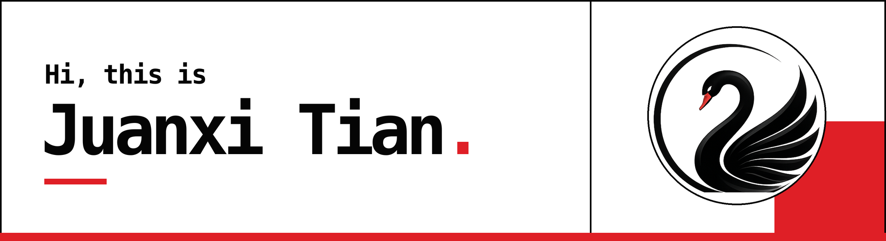
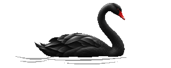

<h3 align="center">田隽熙(世憬)｜Juanxi Tian </h3>

**Research interest:**
- World Model
- Agentic Multimodal

🌏 Personal Homepage: https://tianshijing.github.io
📪 E-mail: juanxitian1031@gmail.com 

**I reject all short-term, quick-and-dirty and meaningless research.**

Currently, I am thinking about how to make more of my contributions to the community. I am taking action.

⬅️ Welcome to follow me!

Following are some of my favorite repositories that I have contributed to:

